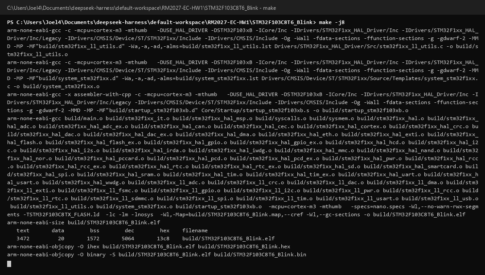

# 电控组首次培训作业

- **王宇浩**
- ***20253007225***

## 一、作业内容

1. 使用 STM32CubeMX 创建第一个 STM32F103 工程，并完成编译
2. 编写本 README：一号标题 + 无序列表，姓名**粗体**、学号***粗体 + 斜体***
3. 在 GitHub 创建公开仓库，提交编译截图与本 README

## 二、工程信息

| 项目 | 内容 |
| --- | --- |
| 主控芯片 | STM32F103C8T6（ARM Cortex-M3，LQFP48，64 KB Flash / 20 KB SRAM） |
| 开发板 | STM32F103C8T6 最小系统板 |
| 配置工具 | STM32CubeMX |
| 系统时钟 | HSE 8 MHz → PLL ×9 → SYSCLK 72 MHz |
| 调试接口 | Serial Wire（SWD） |
| 实现功能 | PC13 板载 LED 以 500 ms 周期翻转（1 Hz 闪烁） |

## 三、编译结果

编译过程无 error、无 warning，固件大小：

```text
   text    data     bss     dec     hex   filename
   3472      20    1572    5064    13c8   STM32F103C8T6_Blink.elf
```

编译完成后命令行输出截图：



## 四、说明

工程源码仅保存在本地，仓库中按要求只提交**编译截图**和 **README.md**。

- 作业日期：2026 年 10 月